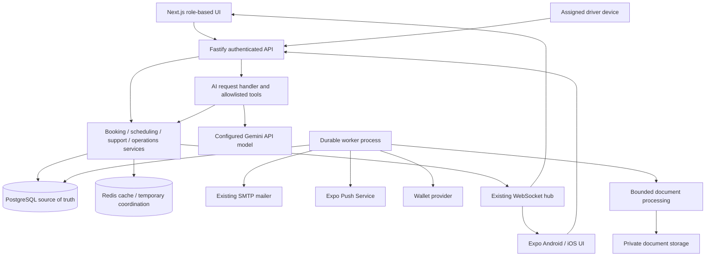

# Bus Aesh Platform Expansion Implementation Plan

> **For agentic workers:** REQUIRED SUB-SKILL: Use executing-plans to implement this plan task-by-task. Subagent-driven-development is an alternative only after the user selects delegated execution. Steps use checkbox syntax for tracking. This document authorizes planning only; do not start implementation from the document alone.

**Goal:** Deliver the fifteen capabilities in the companion specification as incremental, independently testable additions to Bus Aesh.

**Architecture:** Keep the existing modular monolith and shared TypeScript contracts. Extract reusable domain operations from route handlers where needed, introduce durable PostgreSQL background jobs, and expose narrowly authorized server tools to a single AI provider. Separate read-only AI assistance from deterministic booking/payment/scheduling execution.

**Tech Stack:** Existing Next.js/React/Tailwind, Expo/React Native, Fastify, Zod, PostgreSQL/Drizzle, Redis, Nodemailer; official `@google/genai` for AI; existing `expo-notifications` plus Expo push delivery; private S3-compatible document storage for import/review; Google Wallet API for initial wallet support. Exact new dependency versions must be checked against the installed SDK and lockfile when their task starts.

**Spec:** [Platform expansion specification](2026-10-16-platform-expansion-spec.md). Current implementation reference: [README](../../../README.md).

## Global constraints

- All companion-spec constraints apply to every task.
- Preserve the existing API/provider interfaces while extracting shared operations. Introduce no synthetic live fallbacks.
- Keep existing email outbox behavior intact; add separate non-email jobs instead of silently changing its payload contract.
- Server validates tenant/user scope, current role/session, fare, trip eligibility, ownership, and current availability on every operation.
- AI receives minimum necessary data, never SMTP credentials, passwords, raw JWTs, or unrestricted passenger manifests.
- Authentication-dependent responses are private and must not be shared through public caches.
- Model tools are allowlisted and bounded: maximum four model/tool cycles per request, ten returned trips, configurable token/context limits, and a 20-second request deadline. Apply per-account rate limits and a deployment-configured daily spend limit before enabling AI.
- Every write uses an idempotency key and audit entry where applicable. Retries must reuse the same key; never blindly retry ambiguous booking or payment POSTs.
- Use existing focused-check conventions or Node's built-in test runner; no new test framework. Each task adds the smallest meaningful regression check and runs it before/after implementation, then commits the reviewed deliverable.

## Review focus

1. Parallel booking, swap, seat-hold, and waitlist acceptance cannot claim one seat twice: test in Tasks 1 and 4.
2. Repeated callbacks, delayed jobs, and provider timeouts cannot trigger duplicate business mutations: test in Tasks 1, 3, 4, and 7.
3. Cairo daylight-saving changes and late schedule changes must not send misleading reminders: test in Tasks 1 and 3.
4. Malicious chat/document text cannot access another rider's data or invoke privileged actions: test in Tasks 7, 9, and 11.
5. Stale GPS, cancelled/reissued tickets, and invalidated offers must visibly stop being valid: test in Tasks 4, 12, and 13.

## Starting architecture

Initially retain one API replica and one worker deployment. The current WebSocket hub is process-local; multiple replicas require event fan-out before scaling. The existing email worker can remain inside the API until explicitly moved; run exactly one configured email-worker topology to avoid competing ownership assumptions. Job leases must be bounded, renewed for long processing, and fenced when updating results.

### Technology decisions

| Concern | Starting choice | Reason / gate |
| --- | --- | --- |
| API/domain layer | Fastify + typed TypeScript services | Reuse current auth and booking invariants |
| Storage | PostgreSQL + Drizzle migrations | Transactional reservations, job state, auditability |
| Background work | PostgreSQL jobs with `SKIP LOCKED`, separate Node entrypoint | Reuse existing outbox approach; no extra queue service |
| AI | `@google/genai`, configurable Gemini model, structured tool arguments/results | One provider; verify model access and data terms before rollout |
| Knowledge | Admin-approved FAQ/policy records, PostgreSQL text search initially | No vector database needed for a small policy corpus |
| Document processing | Gemini PDF/image input; optional text extraction only if measured need | Structured proposals validated by Zod; never auto-publish |
| Upload storage | Private S3-compatible bucket, signed URLs, AWS SDK | Durable uploads outside public web assets; provision only for document tracks |
| Mobile push | Existing Expo notifications client + Expo push API | Requires FCM/APNs credentials, receipts, device-token lifecycle |
| Maps | `react-native-maps` compatible with installed Expo; MapLibre GL JS on web | Map credentials/tiles and attribution required; use licensed providers |
| ETA | Route/stop geometry and observed travel times | No LLM-generated ETA; stale/no-route data means unavailable |
| Wallet | Google Wallet first; Apple PassKit separately | Issuer approval, secrets/certificates, lifecycle updates required |
| Analytics | PostgreSQL aggregates + existing UI tables; chart dependency only if needed | Build trustworthy metrics before prediction |

No paid service purchase, provider credential creation, Expo upgrade, or live deployment is implied by this plan.

## File and module map

Existing files to extend: `apps/api/src/db/schema.ts`, `apps/api/src/index.ts`, API route files, `packages/shared/src/index.ts`, `apps/web/hooks/useAppStore.tsx`, web role pages, and mobile home/scanner/context/components.

New files are grouped by feature and created only when that feature starts:

| Proposed path | Responsibility |
| --- | --- |
| `apps/api/src/services/booking.service.ts` | Shared transaction-safe booking mutations used by existing routes and later features |
| `apps/api/src/jobs/{repository,worker}.ts`, `apps/api/src/worker.ts` | Durable job claiming, execution, retries, shutdown |
| `apps/api/src/features/notifications/{routes,service,jobs}.ts` | Device registration, preferences, reminders, receipt processing |
| `apps/api/src/features/waitlist/{routes,service}.ts` | Queue, seat offers, expiry, atomic acceptance |
| `apps/api/src/features/preferences/{routes,service}.ts` | Saved recurring journey preferences |
| `apps/api/src/features/analytics/{routes,service}.ts` | Authorized metrics and forecast inputs |
| `apps/api/src/features/ai/{routes,service,tools,schemas}.ts` | Provider calls, budgets, role-scoped tools, response validation |
| `apps/api/src/features/support/{routes,service}.ts` | Approved policy content and support escalations |
| `apps/api/src/features/imports/{routes,service,jobs}.ts` | Upload validation, draft extraction, preview, approval |
| `apps/api/src/features/disruptions/{routes,service}.ts` | Service incidents, affected bookings, approved notices |
| `apps/api/src/features/receipts/{routes,service,jobs}.ts` | Extraction proposals and review findings |
| `apps/api/src/features/tracking/{routes,service}.ts` | Authorized location ingestion and observation-based ETA |
| `apps/api/src/features/wallet/{routes,service,jobs}.ts` | Authorized pass creation and lifecycle updates |
| `apps/api/src/features/forecasting/{routes,service,jobs}.ts` | Baselines, evaluation, recommendations |
| `apps/web/components/{notifications,waitlist,assistant,tracking}/` | Focused web UI modules |
| `apps/mobile/src/features/{notifications,waitlist,assistant,tracking}/` | Mobile feature UI/client helpers |
| `apps/api/checks/<feature>.check.ts` | Focused Node/tsx regression checks using isolated data |

Service functions accept an authenticated `Actor = {userId, role, sessionId}` derived by middleware, never model-supplied identity. Shared public schemas live under `packages/shared/src/` and remain exported through its existing entrypoint. Avoid splitting unrelated current modules just to match the proposed directory layout.

## Delivery order and dependencies

| Stage | Tasks | Shippable result |
| --- | --- | --- |
| Foundation | 1 | Safe shared operations and durable work |
| Everyday product improvements | 2–6 | Mobile parity, reminders, waitlist, preferences, email dashboard, analytics |
| Useful AI assistants | 7–8 | Grounded booking/support and read-only admin assistance |
| Operational AI tools | 9–11 | Timetable drafts, disruption coordination, receipt review |
| External integrations | 12–13 | GPS/ETA and wallet access |
| Data-dependent optimization | 14 | Evaluated demand recommendations |
| Release gates | 15 | Staged, observable, documented rollout |

Tasks 5 and 6 need Task 1 but can ship independently of waitlisting. Task 9 uses the AI service from Task 7; Task 10 adds alternatives from Task 7 and alerts from Task 3. Tracking needs its own real device/route prerequisites. Forecasting requires Task 6 and sufficient reliable history.

## Task 1: Shared business operations, idempotency, and durable jobs

**Files:** modify booking/supervisor routes and schema; create `services/booking.service.ts`, `jobs/repository.ts`, `jobs/worker.ts`, `worker.ts`, and `checks/foundation.check.ts`.

**Interfaces:** `createBooking(actor, input, idempotencyKey): Promise<BookingResult>`; `enqueueJob(tx, {type, eventKey, payload, runAt}): Promise<string>`; `runWorker({signal}): Promise<void>`. Define Zod request schemas and result unions in the shared package before consumers are implemented.

- [x] Add isolated checks for simultaneous booking/seat changes, duplicate idempotency keys, different payload reuse of a key, expired claims, restart recovery, and Cairo DST conversion.
- [x] Extract existing booking transactions without changing payment policy; keep all current callers on the shared implementation.
- [x] Add `idempotency_records` with actor/operation/key uniqueness and a request hash. Commit successful business mutation and result atomically; reject key reuse with a different hash. Define a 24-hour replay window with controlled cleanup.
- [x] Add `background_jobs` with unique event key, schema-validated payload, lease/fencing token, attempts, scheduled time, and sanitized errors. Do not store raw secrets/tokens in job payloads.
- [x] Add a separate worker startup/shutdown command and Compose service when jobs first ship. Claim business work in PostgreSQL; use Redis only for non-authoritative acceleration.
- [x] Run `npx tsx apps/api/checks/foundation.check.ts`; require no double booking or duplicate mutation after timeout/retry, recoverable leases, and correct local dates. Run shared/API builds; commit.

## Task 2: Mobile parity with existing web flows

**Files:** mobile home/components/types and new `src/i18n/`; shared booking schemas; `routes/bookings.routes.ts`; `checks/mobile-booking.check.ts`.

**Interfaces:** extend `RoundTripBookingInput` to accept `paymentMethod: 'none'` only if both stored fares are exactly zero; preserve paid web behavior. Reuse existing `/api/bookings/round-trip` and authenticated manifest/boarding endpoints.

- [ ] Add server checks: both-zero succeeds; either positive fare rejects before either booking exists; one conflicted leg leaves no partial booking.
- [ ] Add arrival/return selection, combined availability, paired tickets, ambiguous-result recovery, and idempotent round-trip submission in mobile.
- [ ] Add Arabic/English dictionaries and tested RTL layout behavior; keep current dark-blue assets. Use Expo-compatible localization dependencies only when required.
- [ ] Add supervisor trip manifest, boarding counts, authorized manual boarding, and refresh. Keep payment controls and admin dashboard out of this mobile parity task.
- [ ] Run the focused check, mobile types, SDK dependency check, native Android assembly, and emulator rider→paired tickets→supervisor flow. Review Arabic/RTL on small screens. Commit; record iOS source-only limits.

## Task 3: Notifications, reminders, and service alerts

**Files:** notification feature files, schema, client registration/settings UI, `checks/notifications.check.ts`.

**Interfaces:** `scheduleReminder(tx, bookingId, kind): Promise<void>`; `sendNotice({recipientId, templateKey, data, eventKey}): Promise<DeliveryResult>`. Add authenticated `POST/DELETE /api/devices`, `GET/PUT /api/notification-preferences`, and paginated `GET /api/notifications`.

- [ ] Add failing checks for duplicate jobs, cancelled bookings, moved departure times, DST, stale device tokens, and provider timeout/receipt failure.
- [ ] Add `device_tokens`, `notification_preferences`, `notifications`, and `notification_deliveries`; separate inbox records from transport attempts. De-register tokens on logout/account change; never notify a later device owner about an earlier user.
- [ ] Schedule configurable reminders (initial proposals: 60 and 15 minutes before departure). Re-read booking, trip, policy, and preferences immediately before sending. Reschedule/cancel reminders when trips change.
- [ ] Integrate Expo token registration, opt-in/permission states, FCM/APNs credentials, push tickets and receipts, invalid-token retirement, and bounded retry. Add web in-app inbox; browser background push is a separate future extension.
- [ ] Add administrator-authored service alerts scoped by trip/route/date; display notices in web/mobile and use existing SMTP only where configured/preferences permit.
- [ ] Run focused checks and a real-device push test; distinguish provider acceptance from device display. Commit.

## Task 4: Waitlist and expiring seat offers

**Files:** waitlist feature files, booking/hold/swap services, seat reads, schema, web/mobile waitlist UI, `checks/waitlist.check.ts`.

**Interfaces:** `joinWaitlist(actor, tripId)`; `offerNextSeat(tx, tripId)`; `acceptOffer(actor, offerId, idempotencyKey): Promise<BookingResult>`. Endpoints: `POST /api/waitlist`, `DELETE /api/waitlist/:id`, `POST /api/waitlist/offers/:id/accept`.

- [ ] Test FIFO ties, concurrent direct booking/offer acceptance/swap, duplicate acceptance, cancellation, expired offers, and empty queue.
- [ ] Add `waitlist_entries` and PostgreSQL `seat_offers`; proposed initial offer duration is five minutes and one active entry per rider/trip. Pilot one-way zero-fare trips first; explain unsupported paired/paid requests.
- [ ] Enforce reservations in every seat claimant: direct booking, temporary holds, admin/supervisor swaps, seat availability, and offer acceptance. Serialize allocation by trip/seat transaction locks; do not implement offers as fake bookings.
- [ ] Notify the next rider only after committing an exclusive offer. Expiry advances the queue; accepting revalidates eligibility/fare/session and creates a normal ticket in one transaction.
- [ ] Run isolated concurrency checks and QA fixture flows; require at most one winner and no leaked reservations. Commit. Extend paired offers later only after defining atomic two-leg reservations.

## Task 5: Saved recurring journey preferences

**Files:** preferences feature, schema, account/booking UI, `checks/preferences.check.ts`.

**Interfaces:** `JourneyPreference = {routeId, weekdays, direction, preferredLocalTime, timezone}`; authenticated `GET/PUT /api/journey-preferences`.

- [ ] Test invalid weekdays/time zones, deleted routes, missing timetable dates, DST, and account isolation.
- [ ] Store preferences and preselect matching existing scheduled trips. Offer reminders/favorites; do not auto-book seats or create a university timetable.
- [ ] Add edit/delete preferences in web/mobile, with clear no-match state. Run checks/types and device/browser review; commit.

## Task 6: Email operations dashboard and baseline analytics

**Files:** web admin components/pages, existing admin/email-outbox routes, analytics feature, schema indexes if measured, `checks/analytics.check.ts`.

**Interfaces:** `GET /api/admin/analytics?from&to&routeId`; `GET /api/admin/email-outbox` with bounded filters/cursor; retain existing failed-list/retry actions.

- [ ] Define metric denominators: booking occupancy by available capacity; boarding rate by eligible confirmed bookings; no-show only for completed trips after the reporting cutoff. Distinguish booking cancellation from trip cancellation and never label receipt volume as revenue.
- [ ] Add tests for cancelled/rescheduled trips, swapped bookings, paired legs, zero denominators, date windows, CSV formula injection, and unauthorized access.
- [ ] Implement parameterized aggregate queries with a maximum 90-day interactive window and pagination/export limits; add indexes based on query plans, not guesses.
- [ ] Build dashboard filters, occupancy/no-show/cancellation/boarding summaries, failure counts, sanitized job detail, and deliberate retry controls.
- [ ] Run focused checks and desktop/phone admin QA; commit. Forecasting consumes these definitions later.

## Task 7: Grounded Arabic/English booking and support assistants

**Files:** AI/support features, `packages/shared/src/assistant.ts`, web/mobile assistant UI, `checks/assistant.check.ts`.

**Interfaces:** `POST /api/assistant/messages` returns `{text, cards, citations, requestId}`. Allowed tools: `searchTrips(filters)`, `getTripSeats(tripId)`, `getMyBooking(bookingId)`, `getApprovedPolicy(topic)`, `createSupportEscalation(summary)`. Identity comes from middleware. `TripCard` includes real trip ID, fare, departure instant, and a normal booking-screen deep link.

- [ ] Create deterministic provider stubs/checks for no-trip results, conflicting dates, Arabic dates, prompt injection, forged identity, another rider's booking, provider timeout, fabricated IDs, and exhausted budget.
- [ ] Provision verified `GEMINI_API_KEY`/`AI_MODEL` outside clients. Add server-side SDK calls, function schemas, argument/result validation, audit-safe telemetry, request limits, and application-owned tool execution.
- [ ] Interpret relative dates in Cairo and echo the resolved date. Ask a clarification when departure/arrival intent is ambiguous. Cite approved policy version or actual trip/booking data.
- [ ] Return read-only cards and hand off to ordinary booking UI. Do not let chat directly cancel/book in the first release. Later conversational writes require a one-use confirmation bound to actor, action hash, expiry, and normal idempotent domain operation.
- [ ] Add approved FAQ/policy editing and versioning plus a support escalation record. A handoff confirmation means an internal ticket exists; external email/Slack messages require configured destination and user authorization.
- [ ] Minimize retained chat data; proposed retention is 30 days with user deletion and admin controls. Do not send full manifests or receipts to the provider. Check provider retention terms before enabling for real users.
- [ ] Run offline stub checks plus a bounded bilingual evaluation set in staging; require zero unauthorized tool successes and zero invented actionable IDs. Include deterministic normal-UI fallback and commit.

## Task 8: Read-only administrator operations assistant

**Files:** AI tools/service, admin assistant panel, `checks/admin-assistant.check.ts`.

**Interfaces:** admin-only tools `getOccupancySummary(filters)`, `listPendingReceiptReviews(filters)`, `listFailedEmailJobs(filters)`, `getAnalyticsSummary(filters)`; all results are filtered/paginated and role-authorized.

- [ ] Test rider/supervisor denial, role changes mid-session, prompt requests for passwords/manifests/raw SQL, unavailable data, and mismatched reported totals.
- [ ] Reuse Task 6 queries; return tables/chart data and links to actual admin screens. Expose no arbitrary SQL and no write tools.
- [ ] Record data interval/as-of time with answers; test desktop/mobile layouts and failure fallback. Run check/builds; commit.

## Task 9: Timetable import assistant

**Files:** import feature/jobs, private storage helper, admin import preview, `checks/imports.check.ts`.

**Interfaces:** `POST /api/admin/timetable-imports`, `GET /api/admin/timetable-imports/:id`, `POST /api/admin/timetable-imports/:id/approve`. Extraction returns `ScheduleDraft` with source page/region, proposed fields, unresolved matches, and draft version.

- [ ] Add tests for malicious document instructions, unsupported/encrypted files, missing date/year, ambiguous bus/route names, duplicate shifts, wrong direction, oversized content, and concurrent draft editing/approval.
- [ ] Provision private object storage; allow PDF/JPEG/PNG, maximum 10 MB and 20 PDF pages initially. Validate MIME/signature and decode in bounded processing; use short-lived signed upload access, quarantine and scanning before processing, and purge raw uploads after seven days unless retained by explicit admin policy.
- [ ] Extract with the configured multimodal model; validate with Zod and match only existing approved route/bus/personnel IDs. Low-confidence or unresolved fields require human correction; never invent a timetable.
- [ ] Show page-linked preview, conflicts, edits, and a final approval action bound to the draft version. Revalidate server rules and publish transactionally using scheduling services, not model SQL.
- [ ] Run bad-file/security/schema checks and a synthetic timetable import; verify retry cannot double-publish. Commit.

## Task 10: Disruption coordination assistant

**Files:** disruption feature, notifications integration, AI tools, admin/supervisor incident screens, `checks/disruptions.check.ts`.

**Interfaces:** `createIncident(actor, {tripIds, kind, expectedDelayMinutes, reason})`; `previewIncidentNotice(incidentId)`; `publishIncident(actor, incidentId, version)`.

- [ ] Test unauthorized affected-rider queries, duplicate publication, changing passenger lists, cancelled alternative trips, missing capacity, and expired delay estimates.
- [ ] Persist incident status/source/timestamps; derive affected bookings in code. Use AI only to draft bilingual messages and summarize real alternatives.
- [ ] Require authorized approval before publishing; send scoped notices through Task 3. Alternative cards do not reserve seats or move riders automatically.
- [ ] Verify affected-rider counts, notice deduplication, and normal booking conflict behavior. Commit.

## Task 11: Receipt review assistant

**Files:** receipt feature/jobs, private storage integration, payment approval UI, `checks/receipts.check.ts`.

**Interfaces:** `analyzeReceipt(actor, receiptId): Promise<ReceiptReview>` returns extracted reference/amount/date, source evidence, uncertainty, and duplicate candidates. Existing payment verification remains a separate administrator action.

- [ ] Test forged text/instructions, different receipt currencies, missing reference, near-duplicate images, reused payment reference, conflicting booking totals, and provider timeout.
- [ ] Reuse private upload limits/quarantine, scope receipt access to authorized reviewers, and redact unnecessary financial identifiers before provider submission. Define deployment-approved retention for financial records separately from timetable uploads.
- [ ] Combine exact content hashes/reference comparisons with AI extraction; perceptual matches are review hints, not fraud verdicts. Show source evidence and uncertainty.
- [ ] Prevent AI from marking paid/refunded. Admin approval re-reads current booking pair/fare/receipt and runs existing transactional verification/outbox logic.
- [ ] Run isolated checks and synthetic receipt QA; no real banking credentials or unapproved financial images. Commit.

## Task 12: Live location and measured arrival estimates

**Files:** tracking feature, approved stop/route geometry, assigned-driver mobile screen, web/mobile maps, `checks/tracking.check.ts`.

**Interfaces:** `POST /api/trips/:id/location` accepts `{lat, lon, accuracyM, recordedAt, sequence}` for an authorized assigned device; `GET /api/trips/:id/tracking` returns `{position, observedAt, stale, nextStops, etaStatus}`.

- [ ] Test replay/out-of-order observations, impossible jumps, unassigned devices, revoked assignment, no consent, background permission denial, expired trip, and stale observations.
- [ ] Add an explicit driver capability/assignment mapping; do not treat any logged-in rider as a tracker. Add start/stop sharing and visible tracking status. Pilot foreground tracking before background-location permissions and battery review.
- [ ] Publish during active trips only, sample approximately every 15 seconds, and mark data stale after 90 seconds. Stop exposing live coordinates after trip completion. Proposed raw-location retention is 24 hours; keep only approved aggregates afterward.
- [ ] Provision map tiles/keys/attribution and verified stop coordinates/route geometry. Show observed location first. Derive ETA from observed route progress/history; no geometry/history means ETA unavailable, never LLM estimates.
- [ ] Validate foreground movement on a real assigned device, stale-state UI and privacy scope. Test background behavior separately on Android/iOS before claiming support; commit.

## Task 13: Wallet tickets

**Files:** wallet feature/jobs, ticket-card actions, `checks/wallet.check.ts`.

**Interfaces:** `POST /api/bookings/:id/wallet/google` returns an authorized save link; provider update jobs follow cancellation, swap, and QR/version changes. Apple extension: separately signed pass download and update registration endpoints after developer/certificate setup.

- [ ] Test another rider's pass request, cancelled/unpaid booking, expired save link, QR reissue, duplicate creation, and delayed wallet updates.
- [ ] Verify Google issuer approval/test users and provision private credentials. Use a stable provider object ID per booking/version policy and the server-issued ticket token; never a static always-valid boarding code.
- [ ] Add wallet actions and idempotent update/invalidation jobs. The API remains authoritative for online scan validity even if a cached wallet pass looks current. Wallet storage does not enable offline boarding.
- [ ] Verify in Google Wallet test mode. Apple Wallet requires an Apple developer account, pass identifier/certificate, HTTPS update service, and real Apple device verification; ship only after that separate gate.
- [ ] Run focused checks and provider/device QA; commit enabled platform only.

## Task 14: Demand forecasts and capacity recommendations

**Files:** forecasting feature/jobs, analytics inputs, admin recommendation view, `checks/forecasting.check.ts`.

**Interfaces:** `forecastDemand({routeId, serviceDate, direction}): Promise<ForecastResult>` returns horizon, baseline/model name, training interval, uncertainty, evaluation, and recommendation; never a schedule mutation.

- [ ] Establish a data gate: at least eight weeks of reliable history and 30 completed comparable departures per route/direction for a first evaluation. Otherwise show insufficient history; these thresholds permit evaluation, not an accuracy guarantee.
- [ ] Start with day-of-week/time-slot historical baselines and waitlist/unserved-demand counts. Separate seats sold from latent demand; sold-out trips censor demand.
- [ ] Test sparse/zero demand, holidays, cancelled trips, outliers, newly added routes, future-data leakage, and rolling time-based validation. Compare against a simple baseline using MAE and appropriate interval coverage.
- [ ] Keep TypeScript/SQL initially. Add a statistical library or separate forecasting runtime only when evaluated results justify it. LLM text may explain numbers but cannot manufacture a forecast.
- [ ] Require reviewed improvement over the baseline before labeling recommendations predictive. Display uncertainty and require admin approval for capacity/schedule changes. Run checks and commit.

## Task 15: Cross-feature QA, rollout, and documentation

**Files:** CI workflows, Compose/worker configuration, README/DEPLOY/CHANGELOG, per-feature check scripts and release evidence.

- [ ] Add independent feature flags for AI, notifications, waitlist, imports, tracking, receipts, forecasting, and wallets; unavailable credentials disable only the affected feature with a clear UI state.
- [ ] Define structured request/job IDs, counts/latency/error metrics, model/provider usage and daily budget alerts. Keep secrets, passenger content, raw chats, and coordinates out of general logs.
- [ ] Complete shared/API/web builds and types, Expo checks, Android release assembly, cold start, bilingual mobile/web journeys, and role separation. Test restart/outage/timeout and job replay on isolated fixtures.
- [ ] Run the complete rider search→booking→notice→ticket→supervisor verification flow; add waitlist expiration/acceptance and incident notification QA. Do not send unsolicited test messages or mutate real schedules.
- [ ] Exercise camera/manual scanning, repeat-scan rejection, concurrent seat claim, paid-trip rejection, revoked pass, stale GPS, and AI refusal boundaries. Native iOS and external provider tests stay explicitly blocked until their prerequisites exist.
- [ ] Perform security review for prompt/document injection, upload handling, cross-user data, location privacy, signing keys, and tool authorization; resolve confirmed critical/major findings before enabling affected features.
- [ ] Review migrations/backups/rollback strategy, deploy additive schema first, enable for QA accounts, then gradually expand. Rolling back code disables flags/workers without deleting committed bookings or outbox jobs.
- [ ] Publish per-release feature matrix, artifacts, model/SDK versions, test evidence, disabled integrations, and known limits. Never move an existing release tag.

## Inputs required before their dependent task

| Input | Needed for |
| --- | --- |
| Verified AI account/model access, spend cap, approved data/retention policy | Task 7 onward |
| FCM/APNs/Expo project credentials, test device consent, reminder policy | Task 3 |
| Approved routes/stops/personnel and representative timetable files | Task 9 |
| Private object storage/quarantine/scanning setup and receipt data policy | Tasks 9 and 11 |
| Assigned tracking devices, permissions, stop coordinates/route shapes, map provider | Task 12 |
| Google issuer account; optionally Apple developer account/certificates | Task 13 |
| Sufficient trustworthy boarding/booking/waitlist history | Task 14 |
| QA accounts/recipients, development fixture, macOS/Xcode for native iOS | Runtime QA |

These are implementation gates, not requests to paste secrets into chat. Independent tasks continue while a provider-specific track awaits prerequisites.

## Sources checked for design choices

- [Gemini function calling](https://ai.google.dev/gemini-api/docs/function-calling): model proposes calls; application-owned code controls tool execution.
- [Expo push overview](https://docs.expo.dev/push-notifications/overview/) and [delivery/receipts](https://docs.expo.dev/push-notifications/sending-notifications/): token lifecycle and provider receipt handling; verify SDK 51 compatibility at implementation.
- [Google Wallet save flow](https://developers.google.com/wallet/generic/overview/add-to-google-wallet-flow): issuer/pass integration; verify release eligibility before public distribution.
- [GTFS trip updates](https://gtfs.org/documentation/realtime/feed-entities/trip-updates/) and [freshness guidance](https://gtfs.org/documentation/realtime/realtime-best-practices/): distinguish observation, prediction, and alerts. Full GTFS export is not required for the initial private university deployment.

## Plan self-review and execution handoff

All fifteen specification capabilities map to tasks. Concurrency, retries, Cairo time boundaries, untrusted AI input, and stale external state have explicit owning checks. Provider prerequisites are isolated so they cannot block ordinary booking. Proposed policies such as reminder times, waitlist offer duration, location retention, and AI budget must be reviewed before their respective task starts.

Recommended execution: native implementation task-by-task, with review at each release boundary; delegated implementation/review is an alternative if selected by the user. This planning request changes documentation only. Review this architecture and choose native or delegated execution before feature implementation begins.
